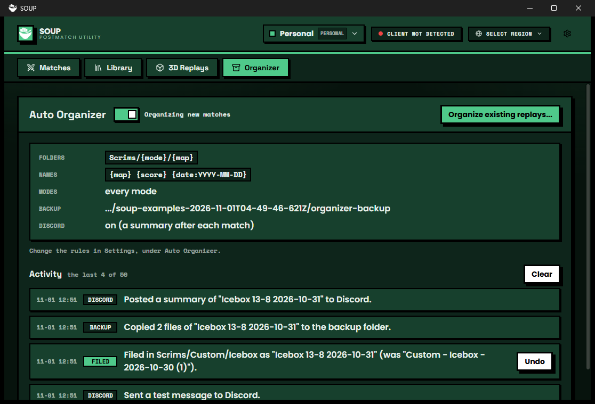

# Auto Organizer

Files each new match into folders, renames it, backs it up and posts a summary to Discord, by rules you set. Everything it does is listed in its tab, and every move can be undone.

## What it does

- **Automatic.** When SOUP saves a finished match (`match-capture/auto-saved`) the replay is filed by your rules: moved into a folder made from a template, renamed from another, copied to a backup folder, and announced on Discord. A failure in any step is a Notice, a warning in SOUP's log and a line in the tab; the other steps and the next match carry on.
- **Log lines.** With automatic organizing off, a saved match is left alone and SOUP's log gets an INFO line saying so (`automatic organizing is off: left match <id> alone`); turning the extension off logs `auto-organizer unloaded` after its last listener is gone. SOUP's self-test waits on both lines instead of sleeping.
- **Organize existing replays...** in the Library's **Import** menu: a preview lists every replay and what would change (or why it would not), and **nothing moves until you press Apply**.
- **Organizer tab.** The rules at a glance, a switch for automatic organizing, and the last 50 things it did, newest first. A filing has an **Undo**: it puts the replay back where it was with its old name, unless you changed it since. If an undo stops half way, press Undo again: it finishes the part that is left. (The folders it made are left; they may hold other replays.)
- **Settings page** (the cog on its row in Settings > Extensions). The rules in three groups (Filing, Backup, Discord), saved for the active profile (a team profile keeps the team's rules), with a live example under each template and a **Reset** beside it.

## The rules

| Rule | What it is |
|---|---|
| Folder template | `{mode}/{map}`, `Scrims/{date:YYYY-MM}`, ... A `/` makes sub-folders. Missing folders are created through the Library module. Empty: folders are left as they are. |
| Rename template | `{date} {map} {score} {result}`, ... Two matches never get the same name in a folder (`(2)` is added). Empty: names are left as they are. |
| Only these modes | `custom, competitive, premier`. Empty: every mode. A replay of another mode is left alone (the log says so). |
| Backup folder | Pick it with **Choose...**. The replay and the match file are copied there after filing, never overwritten. |
| Discord webhook | A Discord webhook address (`https://discord.com/api/webhooks/...`; other addresses are refused, and the page says so). After each new match one embed is posted: map, score, result, top fragger, no links. **Send a test message** tries it. |

Tokens: `{mode}` `{map}` `{date}` (`2026-10-27`) `{date:YYYY-MM}` (any of `YYYY MM DD HH mm`) `{time}` `{score}` (`13-8`) `{result}` (Win, Loss or Draw for the signed-in account; empty when nobody is signed in) `{id}` (the first 8 characters of the match id). A token that is not known stays as written, and the settings say so.

## What it accesses

| | |
|---|---|
| Library | Reads the list, and changes it only through the Library module's own calls (`createFolder`, `moveItem`, `renameReplay`): the same ones SOUP's screens use, so the catalog and the disk stay in step. `app.modules.get("library")`, see [guide 8](../../docs/08-modules.md). |
| Files | Copies the replay and match file to the backup folder you choose (`app.fs.copy`). Reads match files in your Library (read only) for `{result}` and the Discord summary. |
| Network | One `POST` per match to the webhook address you paste, nothing else. **SOUP's log lists the address of each request, and a Discord webhook address contains its secret: do not post your log publicly.** The extension's own log lines never contain it. |
| Riot | None. For `{result}` it asks SOUP for the signed-in account's name (no Riot call). |
| Saved data | `{ rules, log (last 50), handled }`, per profile. |

## How it is built

1. [`src/logic.ts`](src/logic.ts): templates, folder paths, names that do not clash, the plan for one replay. Plain functions, tested in [`tests/auto-organizer.test.ts`](../../tests/auto-organizer.test.ts).
2. [`src/organizer.ts`](src/organizer.ts): the work, one job at a time: the Library calls, `app.fs.copy`, `requestUrl` for Discord, the activity log and undo.
3. [`src/settings.ts`](src/settings.ts): the rules, with `Setting` and `SettingTab`.
4. [`src/ui.tsx`](src/ui.tsx) and [`src/main.tsx`](src/main.tsx): the tab, the preview dialog, and every `add*` call.

Build it from the repository root with `npm run build:example -- examples/auto-organizer`, then install `dist/auto-organizer` in SOUP with **Settings > Extensions > From a folder**.
