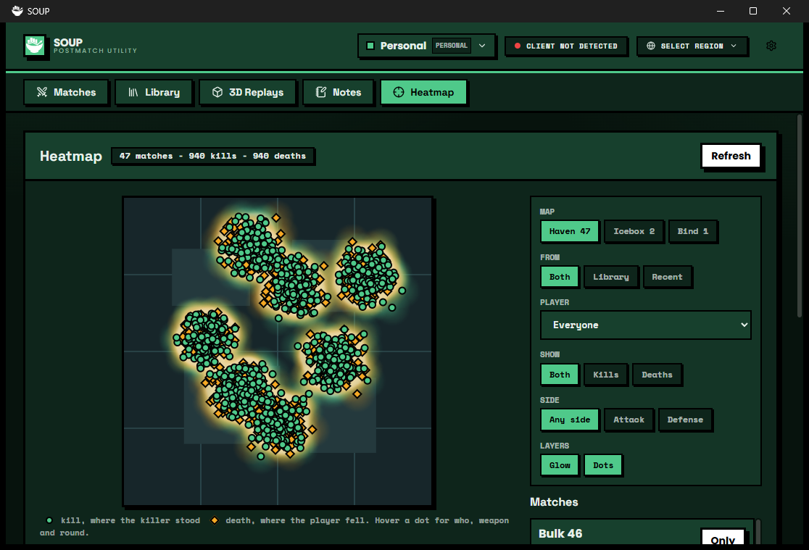

# Heatmap

Kill and death heatmaps on the real minimap, from the match files in your Library and your recent matches.

## What it does

- **Heatmap tab.** Pick a map (only maps you have data for are listed), a source (Library, recent matches, or both), a player (you, a teammate, or everyone), what to show (kills, deaths, or both) and the side (attack, defense, or any). A soft glow shows where it piles up, and a dot marks each event: a circle for a kill (where the killer stood), a diamond for a death (where the player fell). Hover a dot for who killed whom, the round, the weapon and the match.
- **Counts.** The line at the top says how many matches, kills and deaths are on the map; the Matches list on the right shows each match's dots, and **Only** narrows the map to one match.
- **Library: Heatmap button.** On every replay that has a match file: opens the tab filtered to that replay.
- **Works with Scrim Notes.** If [`scrim-notes`](../scrim-notes) is installed and on, a match that has notes gets a **Notes N** button that opens them there, and the count follows when a note is added (the `scrim-notes/changed` event). Without it, nothing changes. This is the example for [guide 13](../../docs/13-working-with-other-extensions.md): an `optionalDependencies` entry, `app.extensions.get("scrim-notes")` and its documented `api`.
- **Settings page** (the cog on its row in Settings > Extensions). The colour of kills and of deaths (a colour picker, with **Reset** to go back to the theme's), which matches the tab starts with, and **Read again**. Saved for the active profile. [`src/settings.ts`](src/settings.ts) is the example of headings, `addColorPicker`, `addExtraButton` and `redraw()`.
- **Smooth with 50 matches.** The glow is drawn once per change on a small canvas and stretched, the dots on top. SOUP's self-test loads 47 more matches and changes the filters eight times with no task longer than a quarter of a second.

"You" is the account the Riot Client is signed in to; without the Riot Client you pick yourself by name in the player list.

## What it accesses

| | |
|---|---|
| Files | Reads the match `.json` next to each Library replay (read only). Keeps two small caches in its own data folder: `maps.json` and `weapons.json`. |
| Network | `https://valorant-api.com/v1/maps` (minimap picture address and the coordinate numbers) and `/v1/weapons` (weapon names), through `app.requestUrl`, cached for 7 days. The picture itself is loaded from `https://media.valorant-api.com`. Nothing about you is sent. If the network is down it uses the old cache, and only says so when there is none. |
| Riot | None of its own. It asks SOUP for the match history and match details (the same cached data SOUP's Matches tab shows) and for the signed-in account's name; with no Riot Client it shows the Library only. |
| SOUP modules | Library, Match Capture. |

## Match file facts it relies on

Measured on real files in a Library. `matchInfo.mapId` (`/Game/Maps/Port/Port`) names the map; `players[]` gives each account's name and team; `kills[]` has `killer`, `victim`, `victimLocation`, `playerLocations[]` (where everyone stood), `round` and `finishingDamage`; `roundResults[]` says who won each round as `Attacker` or `Defender`, which is how a kill gets a side. Some files keep the kills only under `roundResults[].playerStats[].kills[]`; both are read ([`src/logic.ts`](src/logic.ts), tested in [`tests/heatmap.test.ts`](../../tests/heatmap.test.ts)). The world-to-picture formula is valorant-api's: `u = y * xMultiplier + xScalarToAdd`, `v = x * yMultiplier + yScalarToAdd`.

## Settings

None. What you pick on the tab is kept while SOUP runs.

## How it is built

1. [`src/logic.ts`](src/logic.ts): reading a match file, projection, filters. Plain functions.
2. [`src/mapdata.ts`](src/mapdata.ts): `app.requestUrl` with a 7-day cache file, and the stale cache as the fallback.
3. [`src/controller.ts`](src/controller.ts): the state (a new snapshot object per change, for `useSyncExternalStore`) and the loading.
4. [`src/draw.ts`](src/draw.ts): the glow and the dots on a canvas; colours come from the theme variables, so a custom theme recolours them.
5. [`src/ui.tsx`](src/ui.tsx) and [`src/main.tsx`](src/main.tsx): the tab, and every `add*` call.

Build it from the repository root with `npm run build:example -- examples/heatmap`, then install `dist/heatmap` in SOUP with **Settings > Extensions > From a folder**.
