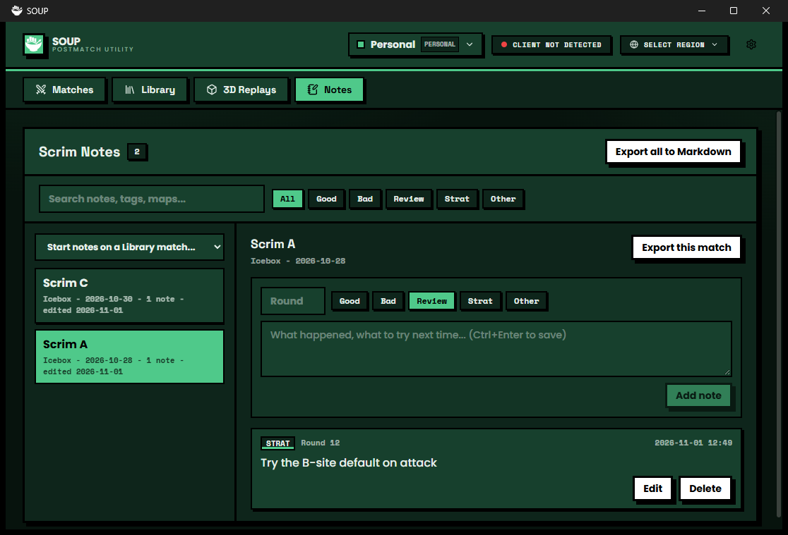

# Scrim Notes

Write notes on any match: per round, tagged, searchable, and exported to Markdown. Your notes are saved with your SOUP profile, so a team profile holds the team's notes.

## What it does

- **Notes tab.** Every match you have notes on, newest edit first. Pick one to read, add, edit and delete notes. Search by text, tag, map or round, and filter by tag (Good, Bad, Review, Strat, Other). A note can be about one round or the whole match.
- **Library: Notes button and badge.** Each replay tile gets a **Notes** button that opens a small dialog with that replay's notes and a quick-add box. A **Notes N** badge shows on the tiles that have notes, and only on those.
- **Matches tab: Add note.** A button on each row of the match history, for a match that is not in your Library.
- **Command.** `Scrim Notes: new note for the last match` (`Ctrl+Alt+N`, or `Ctrl+K` and type it): the newest match from your history, or the newest replay in your Library when the Riot Client is not running.
- **Export to Markdown.** One match or all of them, to a file you choose.
- **Settings.** The tag a new note starts with, whether to show the badge, and **Delete all notes in this profile**.
- **For other extensions.** `app.extensions.get("scrim-notes")?.api` offers `notesFor(matchId)`, `open(matchId)` and `exportMarkdown(path)`, and the event `scrim-notes/changed` (`{ matchId, count }`) tells other extensions when a match's notes change. The [heatmap](../heatmap) example uses both.

## What it accesses

| | |
|---|---|
| Files | Only the Markdown file you choose in the Export dialog. Notes themselves live in SOUP's profile data. |
| Network | None. |
| Riot | None. It reads SOUP's own match history to name a match, which needs no extra call. |
| SOUP modules | Library (the list of replays), Match Capture (history and match details). |

## Saved data

`saveData` stores `{ version: 1, notes: { "<match id>": { title, map, startedAt, entries: [ { id, round?, tag, text, createdAt, updatedAt } ] } }, settings }`. A match that SOUP has no id for is filed under `replay:<library id>`. The `version` field is there so a later release can migrate old data.

## How it is built

Read the files in this order:

1. [`src/model.ts`](src/model.ts): the data, searching and the Markdown export. Plain functions, no SOUP.
2. [`src/store.ts`](src/store.ts): the notes in memory, a subscription for the views, and a save after every change.
3. [`src/ui.tsx`](src/ui.tsx): the tab and the dialog, in React on SOUP's own React, with SOUP's kit (`Button`, `EmptyState`, `inputCls`).
4. [`src/main.tsx`](src/main.tsx): every `add*` call that puts something in SOUP.

The first version of this example never showed a note: its tab printed a counter that nothing redrew. The fix is the pattern in `store.ts`: views read the store with `useSyncExternalStore`, and the store hands out a new object after every change.

Build it from the repository root with `npm run build:example -- examples/scrim-notes`, then install `dist/scrim-notes` in SOUP with **Settings > Extensions > From a folder**.
