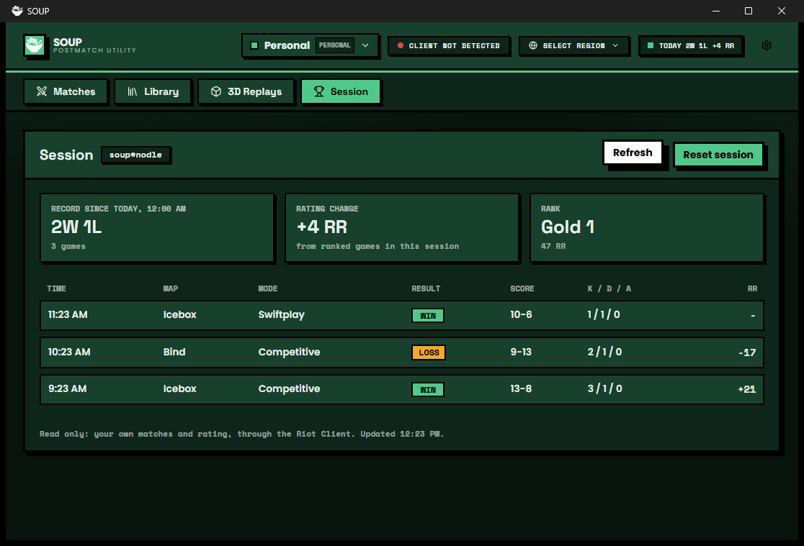

# Session Tracker

Today's wins, losses and rating change in SOUP's header (`Today 5W 2L +42 RR`), with a list of the session's matches. Read only, your own account only.

## What it does

- **Header chip.** `Today 5W 2L +42 RR` (a draw adds `1D`; the RR part appears once a ranked game is in the session). With no Riot Client, or nobody signed in, it says `Not signed in`. Click it to open the Session tab.
- **Session tab.** The record, the rating change, your rank and its RR, and one row per match: time, map, mode, result, score, K/D/A and the rating change. **Reset session** counts from now; **Back to today** returns to the start of today (local time). There is a clear message for "not signed in", "no games yet" and "could not be read", with a button that tries again.
- **Updates by itself.** It reads when a match is saved (`match-capture/auto-saved`), when the Riot Client connects or another account signs in, when you open the tab and the data is a minute old, and when you press Refresh. Otherwise at most every two minutes, and never while you are in a match.
- **Commands.** `Session Tracker: read the session now`, `Session Tracker: reset the session` (Ctrl+K).

## This extension reads your own account and nothing else

Everything it asks Riot is a `GET` about the signed-in account: its match history and the rating change of its last ranked games. It does **not** look up other players, their ranks, or anything Riot keeps hidden in a lobby or in a match. That is the line Riot draws, and the extension is written to stay inside it. Read [guide 9](../../docs/09-riot.md) before you use the Riot calls for something else: Riot may ban accounts for automation or for showing hidden information.

SOUP writes one log line for each call, with this extension's id: `[ext-session-tracker] Riot remote call: GET pd /mmr/...`. Open the debug console with **Ctrl+Shift+D > Extensions** to see them. Tokens are never logged.

## What it accesses

| | |
|---|---|
| Riot | `app.riot.identity()` (the signed-in account, asked of SOUP, not of Riot), `app.riot.remote("GET", { service: "pd", path: "/mmr/v1/players/<puuid>/competitiveupdates?startIndex=0&endIndex=20&queue=competitive" })` for the rating, and SOUP's own match history and match details (`app.matches`). No tokens are requested, no local-client call is made. |
| Network | `https://valorant-api.com/v1/competitivetiers` for tier names (`Gold 2`), cached for 7 days in the extension's data folder. Nothing about you is sent. |
| Files | `tiers.json` in its own data folder. |
| Saved data | `{ resetAt }`, per profile: when you last pressed Reset session. |

## Settings

None. The only thing it remembers is when you reset the session.

## How it is built

1. [`src/logic.ts`](src/logic.ts): the session window, win or loss from a match file (from the signed-in account's team), rating sums and the header text. Plain functions, tested in [`tests/session-tracker.test.ts`](../../tests/session-tracker.test.ts).
2. [`src/source.ts`](src/source.ts): everything that touches the Riot Client or the network, behind a small `DataSource` interface. SOUP's self-test swaps it for a stand-in (`plugin.useSource(...)`) to run the signed-in screens without a Riot Client; its signed-in run against a real client is `pnpm selftest:live`.
3. [`src/store.ts`](src/store.ts): the session in memory and the rules for when it is read (the polite part).
4. [`src/ui.tsx`](src/ui.tsx) and [`src/main.tsx`](src/main.tsx): the chip, the tab, and every `add*` call.

Build it from the repository root with `npm run build:example -- examples/session-tracker`, then install `dist/session-tracker` in SOUP with **Settings > Extensions > From a folder**. SOUP shows an extra warning line for it because the manifest says it uses `riot`.
